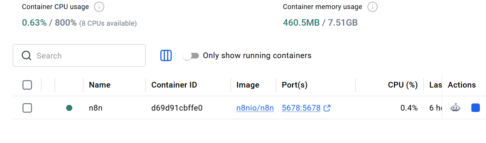
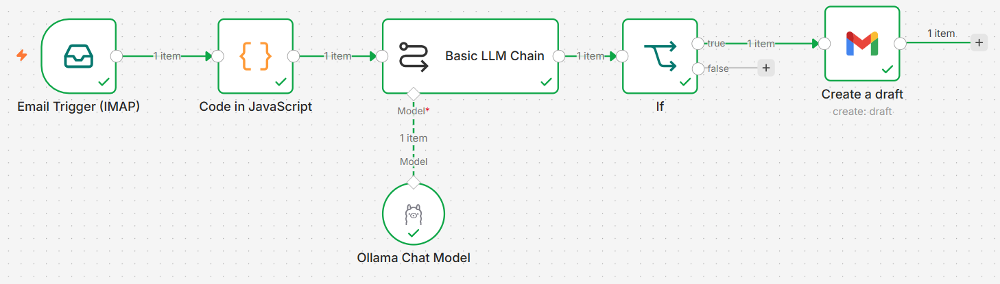
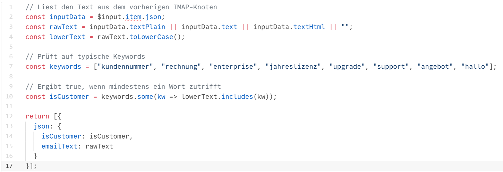
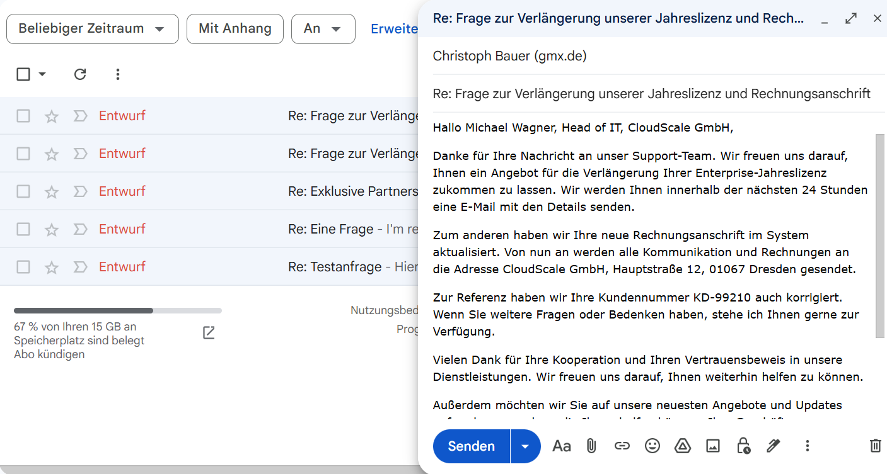

# ✉️ Enterprise Email Automation Engine: Local LLM & Deterministic Workflow Architecture

> **Eine hybride, 100 % DSGVO-konforme E-Mail-Automations-Pipeline zur intelligenten Vorverarbeitung, Klassifizierung und Beantwortung von Kundenanfragen mittels n8n, Ollama (Llama 3 8B) und der Gmail API.**

---

## 🚀 Executive Summary

- **Problem:** Kundenservice-Teams verbringen unzählige Stunden mit dem manuellen Sortieren, Kategorisieren und Verfassen von Erstantworten auf Standard-Kundenanfragen.
- **Lösung:** Entwicklung einer hybriden, datenschutzkonformen E-Mail-Automations-Pipeline mit n8n, Ollama (Llama 3 8B) und der Gmail API.
- **Kernvorteil:** 100 % DSGVO-konforme Datenverarbeitung durch ein lokal gehostetes Open-Source-LLM sowie strikte Zuverlässigkeit durch die Kombination aus deterministischer Keyword-Klassifizierung und generativer KI.

---

## 🏗️ 1. Tech Stack & Infrastructure Setup

### 🛠️ Key Technologies
- **Orchestrierung:** n8n (Self-Hosted via Docker)
- **KI / LLM:** Ollama mit Llama 3 (8B Parameters) (Self-Hosted)
- **Integrationen:** Gmail API / IMAP Trigger
- **Logik:** JavaScript (ES6)



### 💡 Warum diese Architektur für Unternehmen entscheidend ist (Business Relevance)
1. **100 % DSGVO- & Data Privacy Compliance:** Keine Kundendaten (E-Mails, Namen, Rechnungsdaten, Kundennummern) verlassen die eigene Infrastruktur. Es werden keine externen APIs (wie OpenAI oder Anthropic) genutzt.
2. **Kostenkontrolle & Skalierbarkeit:** Keine variablen API-Token-Kosten. Die Pipeline skaliert mit den internen Hardware-Ressourcen ohne laufende Drittanbieter-Kosten.
3. **Vendor-Unabhängigkeit:** Vollständige Kontrolle über das Modell, den Prompt-Context und die Infrastruktur ohne Abhängigkeit von Preisanpassungen oder Rate Limits externer SaaS-Anbieter.

---

## ⚡ 2. Logic & Architecture Overview

### 🧠 Strategic Key Insight: Hybrider Ansatz ("Rule-based + AI Generation")
Ein zentrales Learning des Projekts war der Wechsel von einer rein KI-basierten Klassifizierung zu einem hybriden Modell:
- **Die Challenge:** Kleine lokale LLMs (wie Llama 3 8B) verfallen bei starren Formatvorgaben gelegentlich in Metasprache ("Ich habe den Text analysiert..."). Das führt zu Unschärfen bei harten Weichenstellungen.
- **Die Lösung:** Die Klassifizierung übernimmt ein deterministischer JavaScript-Code (100 % Fehlerfreiheit). Das LLM wird exklusiv für seine Stärke eingesetzt: Das Erfassen von Kontext und das Generieren hochprofessioneller Antworttexte.



---

## 🔍 3. Implementation Details

### A. IMAP / E-Mail Trigger
Liest neu eingehende Mails automatisch aus und übergibt die Plaintext- und HTML-Körper an die Engine.

### B. Code Node (JavaScript Deterministic Matching)
Der JS-Knoten prüft den E-Mail-Inhalt auf kunden- und supportrelevante Trigger-Begriffe (Fallback-Mechanismen über `textPlain`, `textHtml` und `text` inklusive).



### C. Basic LLM Chain (Ollama / Llama 3 8B)
Verwendet den dynamisch übergebenen `emailText`, um maßgeschneiderte Antworten zu verfassen.

### D. Routing & Output (If Node & Gmail API)
- **Data Consistency:** Der If-Knoten greift explizit auf das Ergebnis des Code-Knotens zurück (`$('Code in JavaScript').item.json.isCustomer`), um den Datenstrom absolut stabil zu halten.
- **Human-in-the-Loop Pattern:** Mails werden nicht blind automatisiert verschickt, sondern als Entwurf (Draft) in Gmail gespeichert. Ein menschlicher Mitarbeiter muss lediglich noch prüfen und auf "Senden" klicken.



---

## 🎯 4. Test Case & Validation

**Testergebnis:** Das System hat sämtliche Entitäten (Name, Firmenname, Anliegen, Adressänderung, Kundennummer) fehlerfrei extrahiert, den Kundenpfad korrekt getriggert und einen fertigen Entwurf in unter 3 Sekunden bereitgestellt.

---

## 📈 5. Key Learnings & Strategic Takeaways

- **1. Hybride Architektur (Code + KI) statt reinem LLM:** Kleine lokale LLMs neigen bei strikter Logik zu Unschärfen. Der deterministische JavaScript-Code übernimmt das 100 % fehlerfreie Routing, während das LLM exklusiv für den Text genutzt wird.
- **2. Privacy-First durch On-Premises-Hosting:** Durch die lokale Docker-Infrastruktur (n8n + Ollama / Llama 3) werden sensible Kundendaten vollständig DSGVO-konform verarbeitet – ohne Datenabfluss an externe Cloud-APIs.
- **3. Risikominimierung via "Human-in-the-Loop":** Statt Mails vollautomatisch zu versenden, erzeugt die Pipeline Entwürfe. Das Team spart ~85 % der Tipparbeit, behält aber die finale Freigabekontrolle.

---

## 📂 Repository-Struktur

```text
├── 📁 n8n_workflows/              # Exportierte n8n JSON-Workflow-Definitionen
├── 📜 email_classifier.js         # JavaScript Logik für das deterministische Matching
├── ⚙️ docker-compose.yml          # Lokales Setup für n8n und Ollama
├── 🖼️ n8n-docker-container-status.png     # Docker Container Status
├── 🖼️ n8n-workflow-pipeline.png           # n8n Workflow Architektur
├── 🖼️ javascript-code-node-logic.png      # JavaScript Code Node Ansicht
└── 🖼️ gmail-draft-result-preview.png      # Gmail Entwurf Ergebnis-Preview
